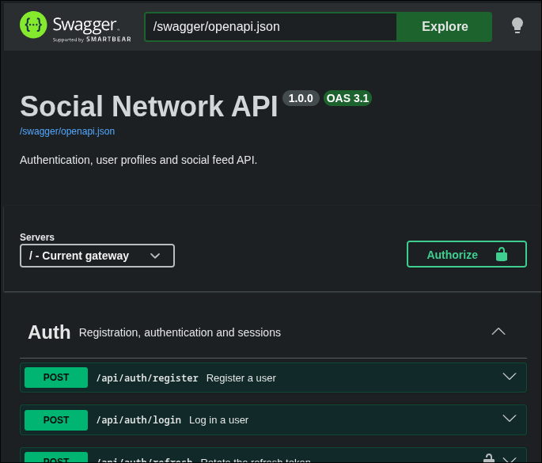

<div align="center">

# social-network

**Многосервисная социальная сеть на npm workspaces: Express 5 + TypeScript на бэкенде, React + Vite на клиенте**

[🇬🇧 Read in English](./README.md)


</div>

---

## О проекте

`social-network` — пет-проект социальной сети, разбитый на отдельные сервисы: авторизация, пользователи и лента. Вся инфраструктура живёт в одном репозитории на npm workspaces:

- **auth-service** — регистрация, логин, токены;
- **user-service** — профили и данные пользователей;
- **feed-service** — посты и лента;
- **frontend-service** — React-клиент, который общается с сервисами по HTTP;
- **@shared/common** — общие для бэкенда вещи (middleware, позже логгер, zod, классы ошибок);
- **@shared/types** — общие типы для сервисов и клиента.

---

## Стек

| Слой | Технологии |
| --- | --- |
| Бэкенд | Node.js 22.12+, Express 5, TypeScript 5.9, `tsx` |
| Фронтенд | React 19, Vite 8, TypeScript 5.9 |
| Монорепозиторий | npm workspaces |
| Качество кода | ESLint 10 (flat config), `tsc --noEmit` |
| Безопасность | `helmet`, `express-rate-limit` |

---

## Требования

- Node.js **>= 22.12.0** (требование Vite 8);
- npm 10+.

---

## Установка и запуск

Клонирование и установка зависимостей:

```bash
git clone https://github.com/Dimidroll06/social-network.git
cd social-network
npm install
```

### Локальный запуск через Docker

Скопируйте пример переменных окружения и замените development-секреты на свои значения:

```bash
cp .env.example .env
docker compose up --build
```

После запуска доступны:

- приложение: http://localhost:5173;
- Swagger UI: http://localhost:5173/swagger/;
- OpenAPI JSON: http://localhost:5173/swagger/openapi.json.

Остановить контейнеры можно командой:

```bash
docker compose down
```

Запуск всего сразу (сервисы и клиент параллельно):

```bash
npm run dev
```

Запуск отдельных частей:

```bash
npm run dev:backend      # только auth, user и feed
npm run dev:auth         # только auth-service
npm run dev:user         # только user-service
npm run dev:feed         # только feed-service
npm run dev:frontend     # только React-клиент
```

### Адреса

| Сервис | Порт | Проверка |
| --- | --- | --- |
| auth-service | 4001 | http://localhost:4001/api/auth/health |
| user-service | 4002 | http://localhost:4002/api/user/health |
| feed-service | 4003 | http://localhost:4003/api/feed/health |
| frontend-service | 5173 | http://localhost:5173 |

Все browser-запросы к API проходят через frontend nginx по префиксам `/api/auth`, `/api/user` и `/api/feed`.

## Swagger UI

Документация API доступна через nginx по адресу [http://localhost:5173/swagger/](http://localhost:5173/swagger/).



---

## Скрипты

| Команда | Что делает |
| --- | --- |
| `npm run dev` | Все сервисы и клиент параллельно |
| `npm run dev:backend` | Только бэкенд-сервисы |
| `npm run dev:<service>` | Отдельный сервис или клиент (`auth`, `user`, `feed`, `frontend`) |
| `npm run start:<service>` | Запуск без watch |
| `npm run typecheck` | `tsc --noEmit` во всех workspaces |
| `npm run lint` / `lint:fix` | ESLint по репозиторию / с автоисправлением |
| `npm run build` | Production-сборка фронтенда |

---

## Структура проекта

```text
social-network/
├── apps/
│   ├── auth-service/              # Express + TypeScript, порт 4001
│   │   └── src/
│   │       ├── controllers/       # HTTP-контроллеры
│   │       ├── services/          # бизнес-логика
│   │       ├── routes/            # основные роуты, подпути собираются в index.ts
│   │       ├── app.ts             # сборка Express-приложения
│   │       └── index.ts           # точка входа
│   ├── user-service/              # та же структура, порт 4002
│   ├── feed-service/              # та же структура, порт 4003
│   └── frontend-service/          # React + Vite, порт 5173
│       └── src/                   # клиентское приложение
├── packages/
│   ├── common/                    # переиспользуемый код для всех микросервисов
│   ├── openapi/                   # единая OpenAPI-спецификация
│   └── types/                     # общие типы приложения
├── public/                        # изображения и прочие материалы проекта
├── eslint.config.mjs              # единый ESLint
├── tsconfig.base.json             # общий tsconfig
├── package.json                   # workspaces и скрипты
├── README.md                      # английская версия
└── README-RU.md                   # русская версия
```

---

## Архитектура

Каждый сервис разбит на слои: **Service** — бизнес-логика, **Controller** — HTTP-слой, **Route** — регистрация методов контроллера на `Router`.

**Запуск.** Код сервисов исполняется через `tsx` без отдельного шага сборки; типы проверяются командой `npm run typecheck`. Фронтенд собирается Vite.

---

## Лицензия

Проект распространяется под лицензией **MIT**. Подробнее в файле [LICENSE](./LICENSE).
